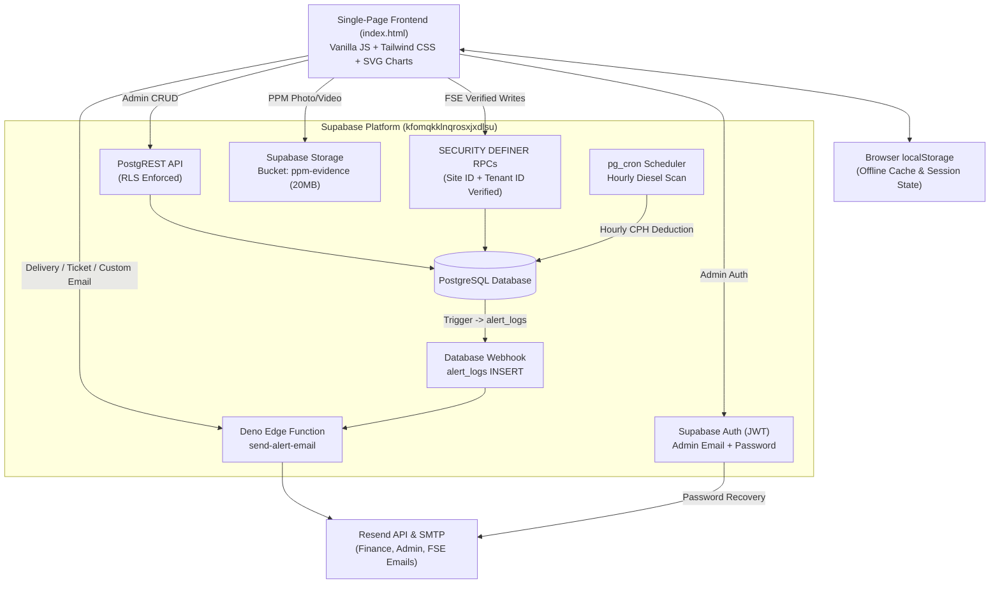
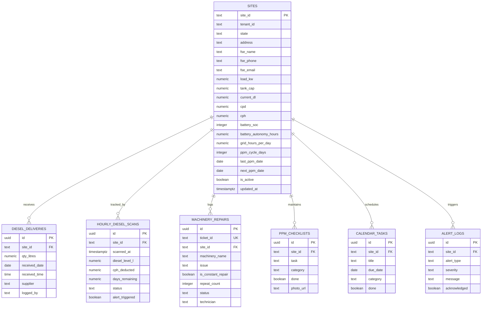
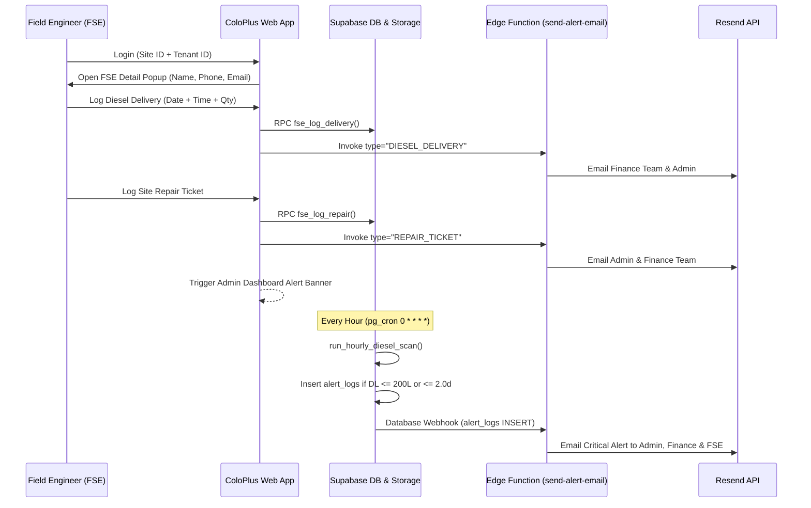

# ColoPlus Tech — Technical Architecture

This document describes the system architecture, security boundaries, database schema, and mathematical correlation engine powering **[ColoPlus Tech](https://coloplus-diesel-tracker.vercel.app/)**.

---

## 1. High-Level Component Architecture

---

## 2. Database Entity-Relationship Diagram (ERD)

---

## 3. Authentication & Security Model

### Dual-Tier Access Control
1. **Admin Tier (Full Write Authorization)**
   - Authenticates via `supabase.auth.signInWithPassword({ email, password })`.
   - Frontend and PostgreSQL RLS both verify `auth.jwt() -> 'app_metadata' ->> 'role' = 'admin'` via `public.is_admin()`.
   - Exclusive permissions:
     - `INSERT` / `UPDATE` / `DELETE` on `public.sites` (including direct fuel calibration, generator size `load_kw`, adding/deactivating sites, and PPM timing).
     - Editing, adding, toggling, and deleting tasks on the 2-Month Calendar.
     - Resolving repair tickets and sending custom Resend emails.

2. **FSE Tier (Site-Scoped Operational Writes)**
   - Field engineers authenticate with **`Site ID` + `Tenant ID`** (no individual Supabase Auth account required).
   - All FSE database mutations execute through **`SECURITY DEFINER` PostgreSQL RPCs** (`supabase/rpc_fse.sql`), which call `public.fse_verify_site(p_site_id, p_tenant_id)` before modifying operational records:
     - `fse_log_delivery` — inserts into `diesel_deliveries` and shifts `last_supply_*` → `previous_supply_*`.
     - `fse_update_bub_light` — updates battery life, SOC, voltage, and utility light hours.
     - `fse_log_repair` — records site-locked repair tickets in `machinery_repairs`.
     - `fse_update_contact` — updates FSE name, phone, and email for PPM reminders.
   - `anon` execute access to `fse_update_fuel_level` is explicitly revoked so only Admins can directly calibrate tank levels.

3. **Zero Secrets in Frontend**
   - Only `NEXT_PUBLIC_SUPABASE_URL_1` and the public `NEXT_PUBLIC_SUPABASE_PUBLISHABLE_KEY_1` exist in `index.html`.
   - `RESEND_API_KEY`, `SUPABASE_SERVICE_ROLE_KEY`, `ADMIN_ALERT_EMAIL`, and `FINANCE_TEAM_EMAIL` live strictly inside **Supabase Edge Function Secrets** and **Supabase Auth SMTP Settings**.

---

## 4. Event & Notification Flow

---

## 5. Mathematical Telemetry Engine

- **Hourly Burn Rate:** $\text{CPH} = \text{CPD} / 24$
- **12-Hour Shift Burn:** $\text{CPD}_{12h} = \text{CPD} / 2$
- **Live Date-Synchronized Fuel Level:**
  $$\text{currentDL} = \max\left(0,\; \text{baselineDL} - \text{CPH} \times \text{elapsedHoursSinceBaseline}\right)$$
- **Autonomy Days Remaining:** $\text{Days} = \text{currentDL} / \text{CPD}$
- **Status Thresholds:**
  - `CRITICAL`: $\text{Days} \le 2.0$ or $\text{currentDL} \le 200\text{ L}$
  - `WARNING`: $2.0 < \text{Days} \le 4.0$
  - `HEALTHY`: $\text{Days} > 4.0$
- **PPM Cycle Calendar Scheduling:**
  - Automatically derives `nextPpmDate` from `hoursToPpm / max(4, 24 - gridHoursPerDay)` (250 DG RH cycle) unless overridden by Admin's custom `lastPpmDate + ppmCycleDays`.
