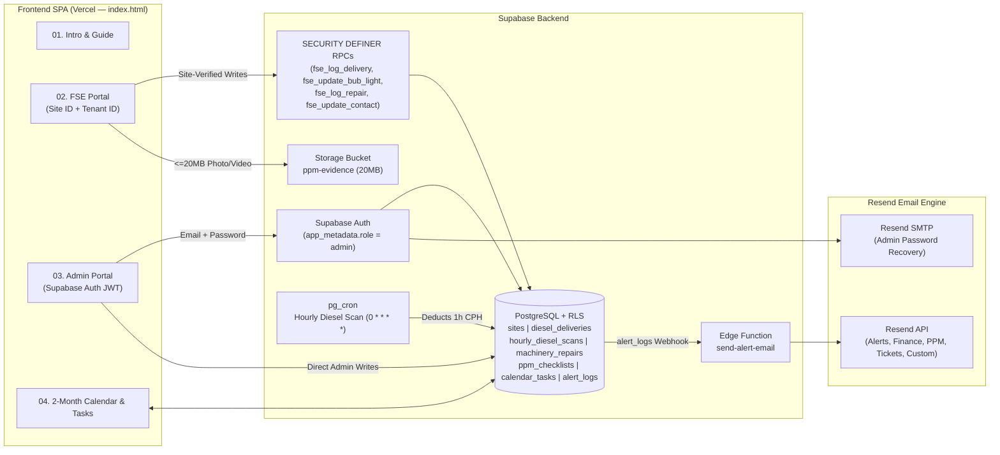

# ColoPlus Tech — Smart Diesel, BUB Power & PPM Operations Platform

[](https://coloplus-diesel-tracker.vercel.app/)
[](https://supabase.com)
[](https://resend.com)
[](#)

An end-to-end telecom tower operations, real-time fuel autonomy, backup battery (BUB), and Preventive & Planned Maintenance (PPM) platform built for **ColoPlus Telecom Infrastructure**. Designed with a high-contrast architectural wireframe UI inspired by `debabratagiri.vercel.app`, backed by **Supabase** (PostgreSQL, Auth, RLS, Storage, Edge Functions, `pg_cron`) and **Resend** automated email notifications.

---

## System Architecture



> For detailed sequence flows, data model ERDs, and the mathematical fuel synchronization engine, see **[`ARCHITECTURE.md`](./ARCHITECTURE.md)**.

---

## Role & Authorization Matrix

| Capability | FSE Portal (`Site ID` + `Tenant ID`) | Admin Portal (`Supabase Auth`) |
| :--- | :---: | :---: |
| View Live Synchronized Fuel & Tank Gauge | Yes | Yes |
| **Input / Calibrate Current Fuel Level** | No *(Admin Only)* | **Yes** |
| Log Diesel Delivery *(Date, Time, Qty, Supplier)* | Yes | Yes |
| View Previous Delivery Date & Delivery Ledger | Yes | Yes |
| Update Battery Life (BUB) & Hours of Light on Site | Yes | Yes |
| Log Site Repair Tickets *(Locked to Active Site)* | Yes | Yes |
| Resolve / Update Repair Ticket Status & Alerts | No | **Yes** |
| Complete 12-Item PPM Checklist + 20MB Photo/Video Proof | Yes | View Submitted Archive |
| **Set PPM Timing / Custom Cycle Days & Sync Calendar** | No *(Admin Only)* | **Yes** |
| View 2-Month Calendar & PPM Schedule | Read-Only | **Full Edit / Add / Delete** |
| Fleet Analytics SVG Charts, FSE Email Directory & Custom Emails | No | **Yes** |
| Add / Edit / Recalibrate / Deactivate Sites & Gen Size (`15/20/30 kW/h`) | No *(Admin Only)* | **Yes** |

---

## Key Features

- **Real-Time Date-Synchronized Fuel Engine:** Automatically calculates live tank volume from the last recorded baseline timestamp and hourly burn (`CPH = CPD / 24`), forecasting days remaining, 200L Reorder Point (ROP), and dry dates.
- **FSE Site-Verified Portal:** Authenticates Field Support Engineers using **Site ID** + **Tenant ID**, opening an **FSE Detail Popup** (capturing FSE Name, Phone, and Email) before unlocking site-scoped fuel delivery logging, BUB/light telemetry, site-locked repair ticketing, and PPM reporting.
- **12-Item Regular PPM Checklist & 20MB Media Proof:** Standardized checks (`AVR`, `TOP GASKET`, `RADIATOR`, `FAN BELT`, `BREAKER`, `MODULES`, `SOLENOIDS`, `KICK STARTERS`, `BUB`, `RECTIFIER`, `DG RH`, `JANITOR`) with up to **20 MB photo/video** uploads to Supabase Storage (`ppm-evidence`), delete controls, and formal **`SUBMIT PPM REPORT`** archiving for Admin review.
- **Admin Command Portal:**
  - **Incoming FSE Repair Ticket Alert Banner** with 1-click inspect & acknowledge.
  - **Custom PPM Cycle Days** (`7`, `14`, `30`, `90`, or any custom day count) auto-synced onto the 2-month calendar.
  - **Fleet Analytics & Alerts** with keyboard-accessible SVG Diesel Runway & BUB-vs-Grid charts.
  - **FSE Email Directory & Custom Resend Email Composer** (Finance Team, All FSEs, Admin, or custom recipients).
  - **Site Recalibration** including **Generator Size** (`15 kW/h`, `20 kW/h`, `30 kW/h`, or custom).
- **Automated Resend Notifications & Password Recovery:**
  - Critical low-diesel alerts to **Admin**, **Finance Team**, and **Site FSE**.
  - Instant **Finance & Admin** notices on diesel deliveries and new repair tickets.
  - Scheduled **PPM Cycle Reminders** to FSE emails.
  - Admin **Password Recovery** via Resend Custom SMTP.
- **Mobile-First & Accessible:** Collapsible sidebar, sticky mobile bottom navigation (`44px+` touch targets), `:focus-visible` keyboard rings, `prefers-reduced-motion` support, and persisted Dark/Light themes.

---

## Project Structure

```text
coloplus-diesel-tracker/
├── index.html                                   # Single-page NOC, FSE & Admin web application
├── server.js                                    # Zero-dependency local Node static server (port 8080)
├── data/
│   └── sites_data.json                          # Structured dataset of the 14 active operational sites
├── supabase/
│   ├── schema.sql                               # Core PostgreSQL tables, RLS policies & hourly scan procedure
│   ├── seed.sql                                 # SQL seed script for the 14 active sites
│   ├── sites_import.csv                         # CSV import alternative matching public.sites columns
│   ├── rpc_fse.sql                              # SECURITY DEFINER RPCs for site-verified FSE writes
│   ├── storage_and_alerts.sql                   # ppm-evidence 20MB Storage bucket + alert_logs trigger
│   ├── functions/
│   │   └── send-alert-email/
│   │       └── index.ts                         # Resend Edge Function (Alerts, Finance, Tickets, PPM, Custom)
│   └── README.md                                # Supabase & Resend deployment instructions
├── ARCHITECTURE.md                              # Detailed system architecture, ERD & mathematical specs
└── README.md                                    # Project overview & quick start
```

---

## Quick Start & Deployment

### 1. Run Locally
```bash
node server.js
# Open http://localhost:8080
```

### 2. Deploy Supabase Backend
Run the SQL files in **Supabase Dashboard → SQL Editor** in order:
1. [`supabase/schema.sql`](./supabase/schema.sql)
2. [`supabase/seed.sql`](./supabase/seed.sql)
3. [`supabase/rpc_fse.sql`](./supabase/rpc_fse.sql)
4. [`supabase/storage_and_alerts.sql`](./supabase/storage_and_alerts.sql)

Then:
- Enable **`pg_cron`** and schedule `public.run_hourly_diesel_scan()` (`0 * * * *`).
- Add `RESEND_API_KEY`, `ADMIN_ALERT_EMAIL`, `FINANCE_TEAM_EMAIL`, and `RESEND_FROM_EMAIL` in **Edge Functions → Secrets** and deploy `send-alert-email`.
- Attach a **Database Webhook** (`Integrations → Webhooks`) on `public.alert_logs` (`Insert`) → `send-alert-email`.
- Configure **Custom SMTP** (`smtp.resend.com:465`) under **Project Settings → Authentication → SMTP Settings** for password recovery.

### 3. Deploy Frontend
Push to `main` — hosted automatically on **Vercel** at **[https://coloplus-diesel-tracker.vercel.app/](https://coloplus-diesel-tracker.vercel.app/)** (zero build step, no Vercel environment variables required).

---

## License

Proprietary internal operations asset for **ColoPlus Telecom Infrastructure**. All rights reserved.
